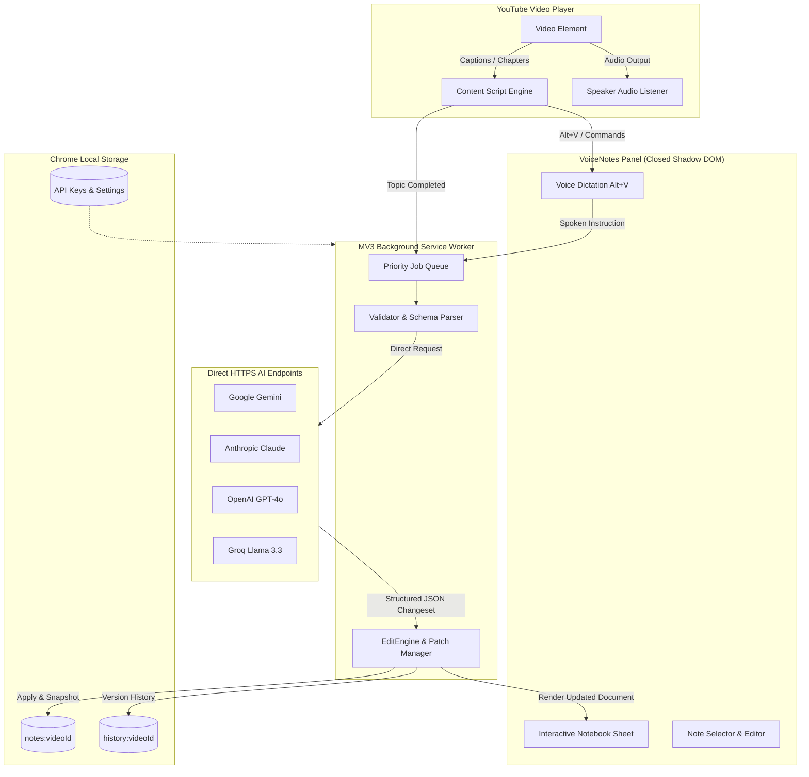

# VoiceNotes 🎙️📝

[](https://developer.chrome.com/docs/extensions/mv3/intro/)
[](https://github.com)
[](https://youtube.com)
[](https://github.com)
[](LICENSE)

> **"Other tools write notes after the video has ended. VoiceNotes synthesizes structured notes live as topics complete, then lets you steer, edit, and expand your document through natural voice commands."**

**VoiceNotes** is an intelligent, real-time AI notebook browser extension built for high-performance video learning on YouTube. It watches along with you, detecting chapter and topic completions to generate concise educational summaries (Heading + Whole Topic Summary). Whenever you want to add an example, simplify a concept, or correct an explanation, press **`Alt+V`**: speak your thought naturally, and the AI immediately integrates it into your living document while preserving all your prior notes.

---

## 🌟 Why VoiceNotes? Key Advantages

| Advantage | What Makes VoiceNotes Superior |
| :--- | :--- |
| ⚡ **Live Topic-Driven Synthesis** | Unlike legacy tools that dump massive transcripts after the video ends, VoiceNotes synthesizes structured takeaways in real time as each distinct topic or chapter reaches completion. |
| 🎙️ **Persistent Voice Document Editing** | Act as an intelligent document editor. Speak natural commands like *"Add an example of supervised learning"* or *"Explain this in simple terms"*. It preserves your previous edits and never wipes your document. |
| ⏱️ **Spoiler-Free Live Reveal** | Notes unlock synchronously as playback reaches each timestamp. Upcoming topic summaries remain hidden until you actually watch that segment. |
| 🚀 **High-Speed Learning (1x to 3x)** | Watch at 1.5x, 2x, or 3x speed without missing a beat. VoiceNotes dynamically tracks playback rate adjustments and scales its synthesis queue automatically. |
| 🔒 **100% Client-Side Privacy** | Zero telemetry, zero external database, and zero third-party proxies. Your API keys are encrypted in local storage, and notes remain strictly on your machine. |
| 🔄 **Non-Destructive Patch Undo** | Edit freely. VoiceNotes maintains inverse operation patches so undoing a voice command (`Ctrl+Z`) reverts only that specific edit without deleting newer notes generated afterward. |
| 🎯 **Targeted Note Editing** | Click any note on screen to select it (`✎ Selected to Edit`), then speak to replace or enhance that specific section with surgical precision. |
| 📤 **Publication-Ready Markdown** | Export your notes with one click into formatted `.md` files featuring clickable YouTube jump links (`t=...s`) that jump the video straight to the exact concept. |

---

## 🚀 Core Features

### 1. Topic-Based Smart Note Generation
- **Heading + Whole Topic Summary**: Intelligently identifies topic transition cues and YouTube chapter markers to generate cohesive educational notes upon topic completion.
- **Noise Filtering**: Automatically purges filler audio tags (`[music]`, `[applause]`, `[laughter]`) and sponsorship chatter to keep notes sharp and academic.

### 2. Persistent AI-Powered Voice Editing
- **Natural Voice Commands**:
  - **Add Information & Examples**: *"Add a concrete example of supervised learning."*
  - **Simplify Explanations**: *"Explain unsupervised learning in simple words for a beginner."*
  - **Rewrite & Refine**: *"Rewrite note 2 to highlight time complexity."*
  - **Organize & Structure**: Create headings, subheadings, and reorder key takeaways.
  - **Remove Content**: *"Delete the note about the sponsor."*
- **Immutable Source of Truth**: Every new voice instruction reads the latest document state, ensuring prior edits and additions are permanently preserved.
- **Clarification Prompts**: If an instruction is ambiguous, VoiceNotes asks for quick clarification without losing your place.

### 3. Click-to-Seek Interactive Timeline
- Every note is paired with an interactive timestamp badge (e.g. `[04:25]`).
- Clicking any timestamp instantly seeks the YouTube video player to that exact moment for effortless revision.

### 4. Resilient Multi-Provider AI Architecture
- Direct, secure integration with the industry's leading AI engines:
  - **Google Gemini**: Gemini 2.0 Flash, Gemini 1.5 Flash, Gemini 1.5 Pro
  - **Anthropic**: Claude 3.5 Sonnet, Claude 3.5 Haiku
  - **OpenAI**: GPT-4o, GPT-4o-mini
  - **Groq**: Llama 3.3 70B Versatile, Llama 3.1 8B Instant
- Built-in connection testing, request prioritization, and exponential backoff retry.

### 5. Speaker Audio Fallback Engine
- For videos where creator captions or auto-captions are unavailable, VoiceNotes seamlessly activates its built-in Web Speech audio listener to capture educational speech directly from the speaker.

---

## 🏗️ Architecture & Data Flow



---

## ⌨️ Keyboard Shortcuts & Quick Controls

| Shortcut / Control | Function | Description |
| :--- | :--- | :--- |
| **`Alt + V`** | **Pause & Voice Edit** | Instantly pauses the video, opens the edit banner, and activates the microphone for hands-free editing. |
| **`Enter ⏎`** | **Submit Edit** | Submits your spoken or typed instruction to the AI document editor. |
| **`Esc`** | **Resume Playback** | Dismisses edit mode and resumes video playback seamlessly. |
| **`Ctrl + Z`** | **Instant Undo** | Reverses the last modification using non-destructive inverse patches. |
| **Click Note / ✎** | **Select Note to Edit** | Highlights a specific note (`✎ Selected to Edit`) to steer or replace it via voice. |
| **`📋 Copy`** | **Copy Markdown** | Copies the full structured notes document with clickable YouTube timestamps to clipboard. |
| **`⬇ Export`** | **Download File** | Downloads a clean, formatted `.md` file titled after the video. |

---

## 📥 Installation & Setup

### 1. Load Extension in Chrome, Brave, or Edge
1. Clone or download this repository:
   ```bash
   git clone https://github.com/your-username/voicenotes.git
   ```
2. Open your Chromium-based browser and navigate to `chrome://extensions/`.
3. Enable **Developer mode** via the toggle switch in the upper-right corner.
4. Click **Load unpacked** in the top-left corner.
5. Select the project directory (`Voice`).
6. The **VoiceNotes** extension icon will now appear in your browser toolbar!

### 2. Connect Your AI Provider
1. Click the **VoiceNotes** extension icon in your browser toolbar (or open `Options`).
2. Choose your preferred AI engine: **Google Gemini**, **Anthropic Claude**, **OpenAI**, or **Groq**.
3. Paste your personal API key.
4. Click **Test Connection** to verify API communication.
5. Click **Save Preferences**. You are ready to take notes!

---

## 📖 How to Use VoiceNotes on YouTube

1. Navigate to any educational video or lecture on [YouTube](https://youtube.com).
2. The VoiceNotes collapsible notebook panel will automatically attach to the right edge of your player.
3. As the presenter covers topics, structured notes appear live with section headings and takeaways.
4. **Speak to Edit anytime**:
   - Press **`Alt+V`** (or click the microphone button).
   - Say: *"Add an example of recursion in Python"* or *"Clarify the difference between let and const"*.
   - Watch VoiceNotes update the document immediately with zero disruption to subsequent notes.
5. Click **Copy** or **Download** to take your comprehensive study guide anywhere (Obsidian, Notion, Logseq, or GitHub).

---

## 🧪 Comprehensive Automated Test Suite

VoiceNotes is engineered for bulletproof reliability, covered by an automated test suite executed using Node.js's native test runner:

```bash
npm test
```

### Verified Test Suites (122 Tests Passing):
- ✔ **Persistent AI-Powered Voice Editing**: Structured JSON parsing, sequential multi-command persistence, clarification prompts, and version rollback.
- ✔ **Topic-Based Smart Note Generation**: Chapter boundary detection, topic transition cue recognition, and heading-then-summary formatting.
- ✔ **Playback Rate Adaptation (1x - 3x)**: Dynamic speed scaling, ratechange tracking, and seeking resilience.
- ✔ **Buttons, Shortcuts & Background Processing**: Global `Alt+V` event isolation bypass, mic permission handling, and note selection workflows.
- ✔ **EditEngine & Inverse Patch Manager**: Add, update, delete, reorganize, and non-destructive undo operations.
- ✔ **Exporter & Markdown Formatter**: Sanitized filenames, YouTube timestamp URL generation, and markdown compilation.
- ✔ **Live Timestamp Reveal**: Progressive note unlocking synchronized with real-time video playback.
- ✔ **Speaker Audio Fallback**: Automated speech-to-text capture for videos without captions.

---

## 📄 License

Distributed under the **MIT License**. See [`LICENSE`](LICENSE) for more information.

---

<div align="center">
  <b>Built for students, developers, researchers, and lifelong learners.</b><br>
  <i>Turn passive video watching into active, voice-steered knowledge capture.</i>
</div>
